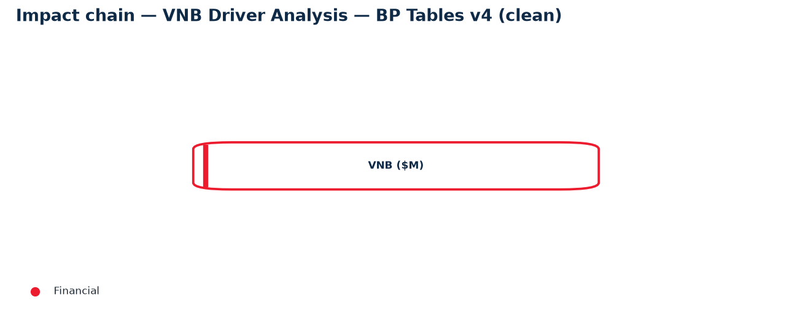
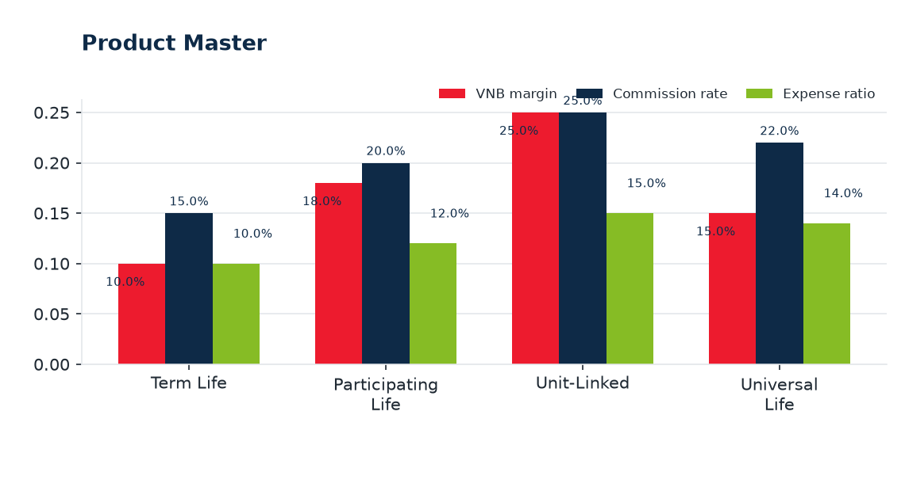
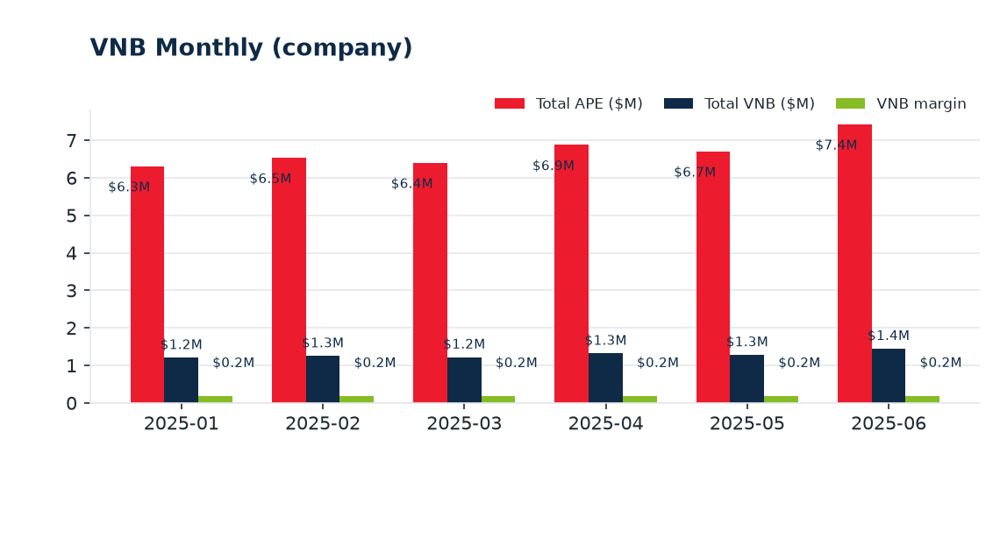

# Alice Private Report

**Date:** 2026-10-29  |  **Ontology pack:** VNB Driver Analysis — BP Tables v4 (clean)  |  **Scope:** Session  |  **Questions analysed:** 1

---

## 1. Executive Summary

- Ontology context — VNB is produced by active agents selling a product mix at a weighted margin.
- Analysed **1 question(s)** (1 rule-engine, 0 AI-assisted).
- Key figures: **Total APE — all periods $40.23M**, **Total VNB — all periods $7.73M**, **VNB margin — all periods 19.2%**, **Average active agents per channel 201.28**.
- Highest Unit-Linked at 25.0%; lowest Term Life at 10.0%. Grouped bars compare VNB margin, Commission rate, Expense ratio.
- Highest 2025-06 at $7.4M; lowest 2025-01 at $6.3M. Grouped bars compare Total APE ($M), Total VNB ($M), VNB margin.

## 2. Q&A Record

### 1. What is the total VNB?

*Mode: **Rules Engine** · 12.4 ms*

The stated **Total VNB is $11.08M** on APE of **$68.00M**.

| Metric | Value |
| --- | --- |
| APE | $68.00M |
| VNB | $11.08M |

**Ontology evidence:** TotalVNB, TotalAPE, BlendedVNBMargin

## 3. Ontology Evidence — Impact Chain

The diagram below shows the directed reasoning chain linking operational drivers to KPI outcomes captured by the analysed questions.

### Entity & attribute definitions

| Entity | Layer | Attributes |
| --- | --- | --- |
| Reporting Period | 1 | Month |
| Distribution Channel | 2 | Channel ID, Channel, Registered agents, Active agents, Active ratio, Average productivity, APE, VNB, VNB margin |
| Agent | 2 | Agent ID, Channel ID, Join date, Certification, Churn risk, Base productivity index |
| Product | 2 | Product ID, Product, Product type, Product VNB margin, Commission rate, Expense ratio, Risk discount rate |
| Product Mix | 3 | Month, Channel ID, Product ID, Share of channel APE |
| Agent Monthly Activity | 3 | Month, Agent ID, Status, Productivity, APE |

### Metric formulas (calculation basis)

| Metric | Formula |
| --- | --- |
| Total APE — all periods | `sum('vnb_monthly','total_ape')` |
| Total VNB — all periods | `sum('vnb_monthly','total_vnb')` |
| VNB margin — all periods | `total_vnb_6m / total_ape_6m` |
| Average active agents per channel | `avg('channel_monthly','active')` |
| Exposure-weighted productivity ($k) | `wavg('channel_monthly','avg_prod','active')` |
| Agency share of VNB | `sum(where('channel_monthly','channel_id','CH001'),'vnb') / total_vnb_6m` |

## 4. KPI and Numbers

| Metric | Value | Unit |
| --- | --- | --- |
| Total APE — all periods | **$40.23M** | $M |
| Total VNB — all periods | **$7.73M** | $M |
| VNB margin — all periods | **19.2%** |  |
| Average active agents per channel | **201.28** |  |
| Exposure-weighted productivity ($k) | **11.10** |  |
| Agency share of VNB | **44.2%** |  |

## 5. Chart Analysis

### 1. Product Master

Highest **Unit-Linked** at 25.0%; lowest **Term Life** at 10.0%. Grouped bars compare VNB margin, Commission rate, Expense ratio.
### 2. VNB Monthly (company)

Highest **2025-06** at $7.4M; lowest **2025-01** at $6.3M. Grouped bars compare Total APE ($M), Total VNB ($M), VNB margin.

## 6. Appendix

### Methodology & assumptions

- Answers are produced by Onti's rule engine against the active ontology pack; AI answers are grounded with the same knowledge base and must not introduce external facts.
- Derived columns and metric formulas are evaluated in declaration order from the active dataset; the calculation basis is listed in the Ontology Evidence section.
- Charts render only tables with 2-15 rows in their active dataset; sections are omitted when their source data is absent.

### Dataset inventory

| Table | Entity | Active dataset | Rows |
| --- | --- | --- | --- |
| Product Master | product | Product master | 4 |
| Agent Master | agent | Agent master | 500 |
| Agent Monthly Activity | agent_month | Agent monthly | 3000 |
| Product Mix Monthly | product_mix | Product mix | 24 |
| Channel Monthly | channel | Channel monthly | 18 |
| VNB Monthly (company) | period | VNB monthly | 6 |
### Generation metadata

| Item | Value |
| --- | --- |
| Report ID | `02be2e3a127e` |
| Generated at (UTC) | 2026-10-29T06:26:00+00:00 |
| Sections included | summary, qa, evidence, kpi, charts, appendix |
| AI interpretation | off |