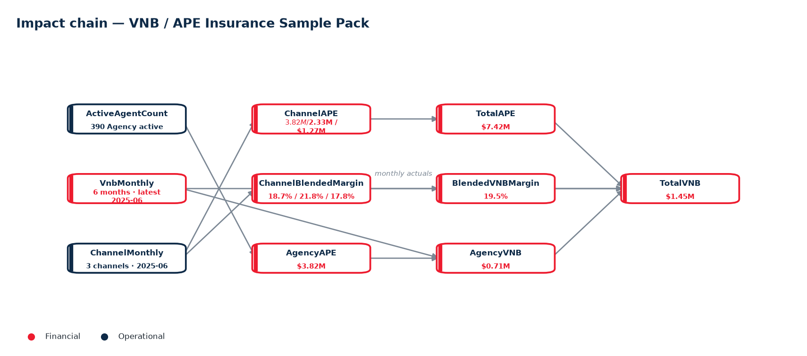
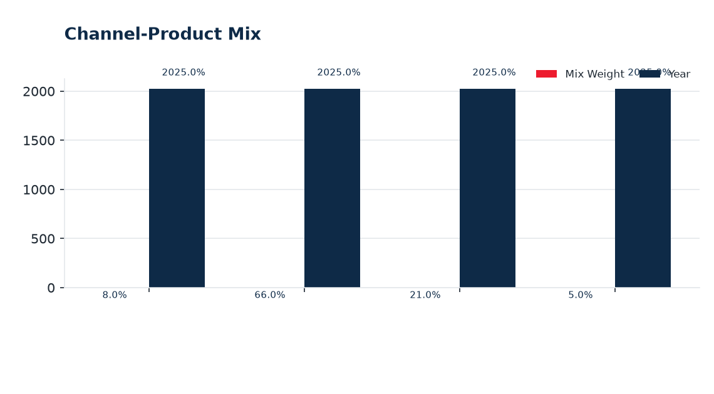
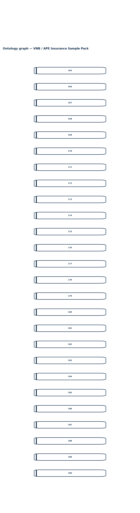

# Full Analytics Report | Scenario: VNB / APE Insurance Sample Pack | Data: Seed: Insurance Products, Seed: Channel-Product Mix, Seed: Distribution Channels, Seed: Agents (+7 more)

**Date:** 2026-10-13  |  **Ontology pack:** VNB / APE Insurance Sample Pack  |  **Scope:** Pack  |  **Questions analysed:** 8

---

## 1. Executive Summary

- Ontology context — Ontology narrative  _Narrative template error: a number is required_
- Analysed **8 question(s)** (8 rule-engine, 0 AI-assisted).
- Key figures: **Business Year –**, **Stated Total APE –**, **Stated Total VNB –**, **Stated VNB Margin –**.
- Highest Unit-Linked at 25.0%; lowest Term Life at 10.0%. Grouped bars compare VNB Margin, Commission Rate, Expense Ratio.
- Highest item 2 at 66.0%; lowest item 4 at 5.0%. Grouped bars compare Mix Weight, Year.

## 2. Q&A Record

### 1. What is the Business Year?

*Mode: **Rules Engine***

_No rule matched — ask this in AI mode for a model answer grounded in the same knowledge base._

### 2. How is Business Year calculated?

*Mode: **Rules Engine***

_No rule matched — ask this in AI mode for a model answer grounded in the same knowledge base._

### 3. What is the Stated Total APE?

*Mode: **Rules Engine***

_No rule matched — ask this in AI mode for a model answer grounded in the same knowledge base._

### 4. How is Stated Total APE calculated?

*Mode: **Rules Engine***

_No rule matched — ask this in AI mode for a model answer grounded in the same knowledge base._

### 5. What is the Stated Total VNB?

*Mode: **Rules Engine***

_No rule matched — ask this in AI mode for a model answer grounded in the same knowledge base._

### 6. How is Stated Total VNB calculated?

*Mode: **Rules Engine***

_No rule matched — ask this in AI mode for a model answer grounded in the same knowledge base._

### 7. What is the Stated VNB Margin?

*Mode: **Rules Engine***

_No rule matched — ask this in AI mode for a model answer grounded in the same knowledge base._

### 8. How is Stated VNB Margin calculated?

*Mode: **Rules Engine***

_No rule matched — ask this in AI mode for a model answer grounded in the same knowledge base._

## 3. Ontology Evidence — Impact Chain

The diagram below shows the directed reasoning chain linking operational drivers to KPI outcomes captured by the analysed questions.

### Entity & attribute definitions

| Entity | Layer | Attributes |
| --- | --- | --- |
| Agent | 3 | Agent Channel ID, Agent ID, Agent Productivity, Certification, Churn Risk, Tenure (Months) |
| VNB Monthly Results | 1 | Month, Total APE, Total VNB, VNB Margin, Agency APE, Agency VNB, Agency share of VNB, MoM VNB change |
| Channel Product Mix | 3 | Channel-Product APE, Channel-Product VNB, Mix Channel ID, Mix ID, Mix Product ID, Year, Product Mix % |
| Channel Monthly KPIs | 2 | Month, Channel ID, Active agents, Avg productivity, APE, Weighted VNB margin, VNB |
| Distribution Channel | 3 | Agent Churn Rate, Agent Count, Average Productivity, Channel ID, Channel Name, Channel Type |
| Agent Monthly Performance | 3 | Month, Agent ID, Channel ID, Status, Productivity, APE, Churn risk |
| Insurance Product | 3 | Commission Rate, Expense Ratio, Product ID, Product Name, Product Type, Risk Discount Rate, VNB Margin |
| Product Mix Monthly | 3 | Month, Channel ID, Product ID, Product mix, VNB margin, Weighted margin component |
| VNB Summary | 3 | Overall VNB Margin, Total APE, Total VNB, Year |
| Scenario Analysis | 4 | Scenario / input, Value, Unit / interpretation |

### Metric formulas (calculation basis)

| Metric | Formula |
| --- | --- |
| Business Year | `cell('kpi', 'year')` |
| Stated Total APE | `cell('kpi', 'ape')` |
| Stated Total VNB | `cell('kpi', 'vnb')` |
| Stated VNB Margin | `cell('kpi', 'margin')` |
| Derived Total APE | `round(sum(rows('channels'), 'ape'), 2)` |
| Derived Total VNB | `round(sum(rows('channels'), 'vnb'), 3)` |
| Derived VNB Margin | `round(derived_vnb / derived_ape, 4)` |
| VNB Gap | `round(derived_vnb - stated_vnb, 2)` |
| Margin Gap | `round(derived_margin - stated_margin, 4)` |

## 4. KPI and Numbers

| Metric | Value | Unit |
| --- | --- | --- |
| Business Year | **–** |  |
| Stated Total APE | **–** | $M |
| Stated Total VNB | **–** | $M |
| Stated VNB Margin | **–** | % |
| Derived Total APE | **$7.42M** | $M |
| Derived Total VNB | **$1.45M** | $M |
| Derived VNB Margin | **19.5%** | % |
| VNB Gap | **–** | $M |
| Margin Gap | **–** | % |

## 5. Chart Analysis

### 1. Insurance Products

Highest **Unit-Linked** at 25.0%; lowest **Term Life** at 10.0%. Grouped bars compare VNB Margin, Commission Rate, Expense Ratio.
### 2. Channel-Product Mix

Highest **item 2** at 66.0%; lowest **item 4** at 5.0%. Grouped bars compare Mix Weight, Year.
### 3. Distribution Channels

Highest **Agency** at 390; lowest **Brokerage** at 70. Grouped bars compare Agent Count, Churn Rate, Avg Productivity.
### 4. VNB Monthly (company)

Highest **2025-06-01** at $7.4M; lowest **2025-01-01** at $6.3M. Grouped bars compare Total APE, Total VNB, VNB Margin.

## 6. Ontology Knowledge Graph

The full entity-relationship graph of the active ontology pack — the same
structure that powers Q&A, the dashboard and the analytics above.

## 7. Appendix

### Methodology & assumptions

- Answers are produced by Onti's rule engine against the active ontology pack; AI answers are grounded with the same knowledge base and must not introduce external facts.
- Derived columns and metric formulas are evaluated in declaration order from the active dataset; the calculation basis is listed in the Ontology Evidence section.
- Charts render only tables with 2-15 rows in their active dataset; sections are omitted when their source data is absent.

### Dataset inventory

| Table | Entity | Active dataset | Rows |
| --- | --- | --- | --- |
| Company KPI (year) | vnb_summary | – | 0 |
| Insurance Products | insurance_product | Seed: Insurance Products | 4 |
| Channel-Product Mix | channel_product_mix | Seed: Channel-Product Mix | 4 |
| Distribution Channels | distribution_channel | Seed: Distribution Channels | 3 |
| Agents | agent | Seed: Agents | 500 |
| VNB Monthly (company) | vnb_monthly | Seed: VNB Monthly (company) | 6 |
| Channel Monthly (KPIs) | channel_monthly | Seed: Channel Monthly (KPIs) | 18 |
| Product Mix Monthly | product_mix_monthly | Seed: Product Mix Monthly | 24 |
| Agent Master | agent | Seed: Agent Master | 500 |
| Agent Monthly Performance | agent_monthly | Seed: Agent Monthly Performance | 3000 |
| KPI Linkage (ontology) |  | Seed: KPI Linkage (ontology) | 7 |
| Scenario Analysis (seed) | scenario_analysis | Seed: Scenario Analysis (seed) | 15 |

### Generation metadata

| Item | Value |
| --- | --- |
| Report ID | `353eb0fa820b` |
| Generated at (UTC) | 2026-10-13T05:46:37+00:00 |
| Sections included | summary, qa, evidence, kpi, charts, ontology, appendix |
| AI interpretation | off |