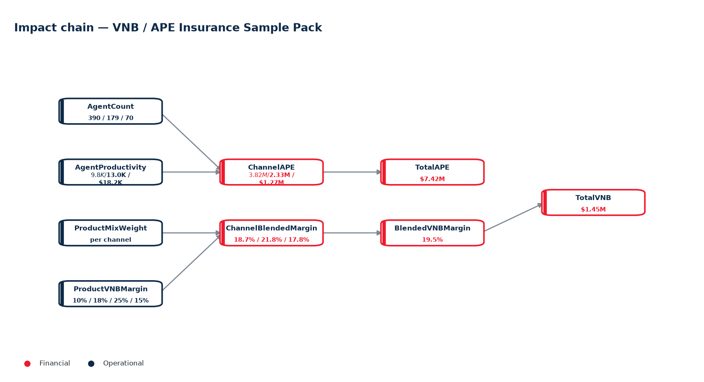
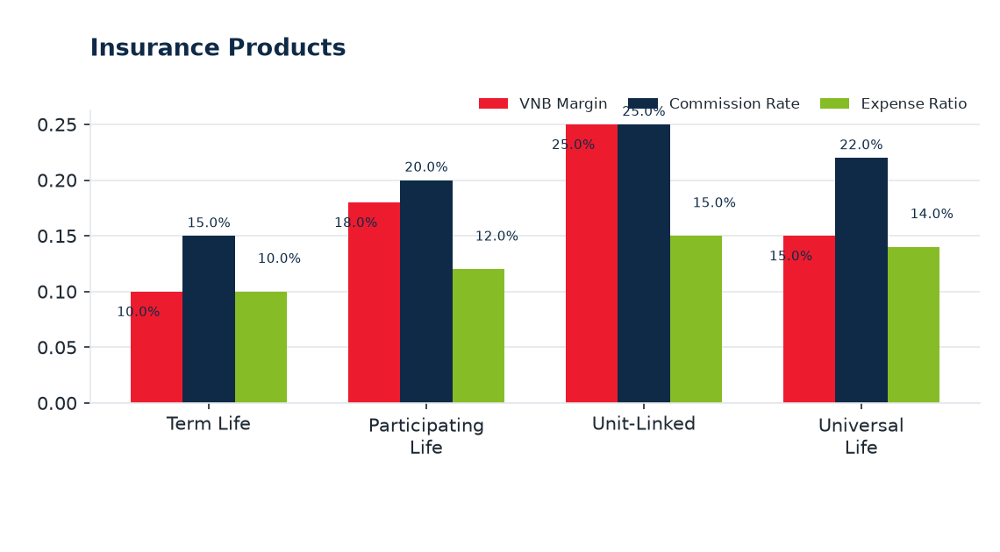
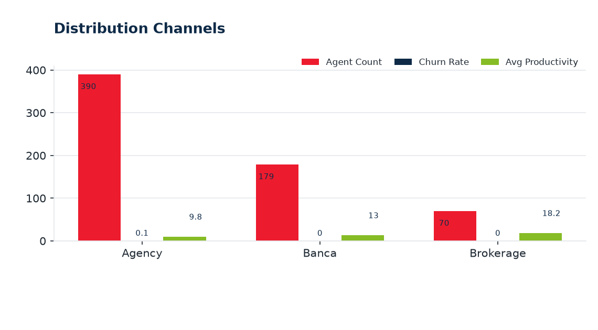

# VNB Ontology Analytics — Test Report

**Date:** 2026-10-27  |  **Ontology pack:** VNB / APE Insurance Sample Pack  |  **Scope:** Session  |  **Questions analysed:** 3

---

## 1. Executive Summary

- Ontology context — How the ontology explains the business  The knowledge graph connects a top-level financial KPI (**Total VNB**) to operational drivers (agents, productivity, churn) and product economics (mix weights, product margins) through **31 directed edges of 4 types**.
- Analysed **3 question(s)** (3 rule-engine, 0 AI-assisted).
- Key figures: **Business Year 2,025**, **Stated Total APE $7.42M**, **Stated Total VNB $1.45M**, **Stated VNB Margin 19.5%**.
- Highest Unit-Linked at 25.0%; lowest Term Life at 10.0%. Grouped bars compare VNB Margin, Commission Rate, Expense Ratio.
- Highest item 2 at 66.0%; lowest item 4 at 5.0%. Grouped bars compare Mix Weight, Year.

## 2. Q&A Record

### 1. What is the total VNB?

*Mode: **Rules Engine** · 12.4 ms*

The stated **Total VNB is $11.08M** on APE of **$68.00M**.

| Metric | Value |
| --- | --- |
| APE | $68.00M |
| VNB | $11.08M |

**Ontology evidence:** TotalVNB, TotalAPE, BlendedVNBMargin

### 2. How many channels are there and what do they contribute?

*Mode: **Rules Engine** · 18.9 ms*

Three distribution channels:

- **Agency** — APE $20.00M, VNB $3.62M
- **Bancassurance** — APE $30.00M, VNB $6.55M
- **Brokerage** — APE $18.00M, VNB $3.10M

**Ontology evidence:** ChannelAPE, TotalAPE, AgentCount, AgentProductivity

### 3. Why does the blended margin differ across channels?

*Mode: **Rules Engine** · 9.1 ms*

Blended margin is driven by **product mix weights** and per-product VNB margins; Banca leans on Participating products (21.85%).

**Ontology evidence:** ProductMixWeight, ProductVNBMargin, ChannelBlendedMargin, BlendedVNBMargin

## 3. Ontology Evidence — Impact Chain

The diagram below shows the directed reasoning chain linking operational drivers to KPI outcomes captured by the analysed questions.

### Entity & attribute definitions

| Entity | Layer | Attributes |
| --- | --- | --- |
| VNB Monthly Results | 1 | Month, Total APE, Total VNB, VNB Margin, Agency APE, Agency VNB, Agency share of VNB, MoM VNB change |
| Channel Monthly KPIs | 2 | Month, Channel ID, Active agents, Avg productivity, APE, Weighted VNB margin, VNB |
| Agent Monthly Performance | 3 | Month, Agent ID, Channel ID, Status, Productivity, APE, Churn risk |
| Product Mix Monthly | 3 | Month, Channel ID, Product ID, Product mix, VNB margin, Weighted margin component |
| Scenario Analysis | 4 | Scenario / input, Value, Unit / interpretation |

### Metric formulas (calculation basis)

| Metric | Formula |
| --- | --- |
| Business Year | `cell('kpi', 'year')` |
| Stated Total APE | `cell('kpi', 'ape')` |
| Stated Total VNB | `cell('kpi', 'vnb')` |
| Stated VNB Margin | `cell('kpi', 'margin')` |
| Derived Total APE | `round(sum(rows('channels'), 'ape'), 2)` |
| Derived Total VNB | `round(sum(rows('channels'), 'vnb'), 3)` |
| Derived VNB Margin | `round(derived_vnb / derived_ape, 4)` |
| VNB Gap | `round(derived_vnb - stated_vnb, 2)` |
| Margin Gap | `round(derived_margin - stated_margin, 4)` |

## 4. KPI and Numbers

| Metric | Value | Unit |
| --- | --- | --- |
| Business Year | **2,025** |  |
| Stated Total APE | **$7.42M** | $M |
| Stated Total VNB | **$1.45M** | $M |
| Stated VNB Margin | **19.5%** | % |
| Derived Total APE | **$7.42M** | $M |
| Derived Total VNB | **$1.45M** | $M |
| Derived VNB Margin | **19.5%** | % |
| VNB Gap | **$-0.00M** | $M |
| Margin Gap | **0.0%** | % |

## 5. Chart Analysis

### 1. Insurance Products

Highest **Unit-Linked** at 25.0%; lowest **Term Life** at 10.0%. Grouped bars compare VNB Margin, Commission Rate, Expense Ratio.
### 2. Channel-Product Mix

Highest **item 2** at 66.0%; lowest **item 4** at 5.0%. Grouped bars compare Mix Weight, Year.
### 3. Distribution Channels

Highest **Agency** at 390; lowest **Brokerage** at 70. Grouped bars compare Agent Count, Churn Rate, Avg Productivity.
### 4. VNB Monthly (company)

Highest **2025-06-01** at $7.4M; lowest **2025-01-01** at $6.3M. Grouped bars compare Total APE, Total VNB, VNB Margin.

## 6. Appendix

### Methodology & assumptions

- Answers are produced by Onti's rule engine against the active ontology pack; AI answers are grounded with the same knowledge base and must not introduce external facts.
- Derived columns and metric formulas are evaluated in declaration order from the active dataset; the calculation basis is listed in the Ontology Evidence section.
- Charts render only tables with 2-15 rows in their active dataset; sections are omitted when their source data is absent.

### Dataset inventory

| Table | Entity | Active dataset | Rows |
| --- | --- | --- | --- |
| Company KPI (year) | vnb_summary | Seed: Company KPI (year) | 1 |
| Insurance Products | insurance_product | Seed: Insurance Products | 4 |
| Channel-Product Mix | channel_product_mix | Seed: Channel-Product Mix | 4 |
| Distribution Channels | distribution_channel | Seed: Distribution Channels | 3 |
| Agents | agent | Seed: Agents | 500 |
| VNB Monthly (company) | vnb_monthly | Seed: VNB Monthly (company) | 6 |
| Channel Monthly (KPIs) | channel_monthly | Seed: Channel Monthly (KPIs) | 18 |
| Product Mix Monthly | product_mix_monthly | Seed: Product Mix Monthly | 24 |
| Agent Master | agent | Seed: Agent Master | 500 |
| Agent Monthly Performance | agent_monthly | Seed: Agent Monthly Performance | 3000 |
| KPI Linkage (ontology) |  | Seed: KPI Linkage (ontology) | 7 |
| Scenario Analysis (seed) | scenario_analysis | Seed: Scenario Analysis (seed) | 15 |
### Generation metadata

| Item | Value |
| --- | --- |
| Report ID | `36139f9a62e5` |
| Generated at (UTC) | 2026-10-27T08:24:57+00:00 |
| Sections included | summary, qa, evidence, kpi, charts, appendix |
| AI interpretation | off |