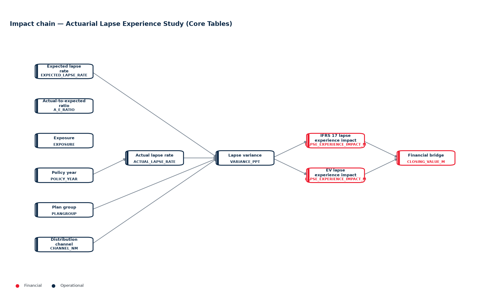
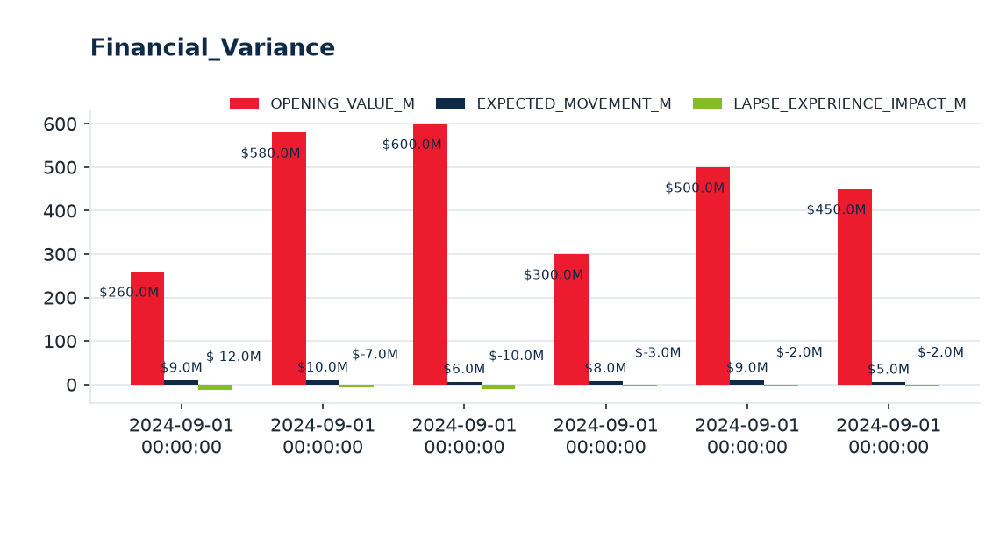

# Alice Private Report

**Date:** 2026-10-27  |  **Ontology pack:** Actuarial Lapse Experience Study (Core Tables)  |  **Scope:** Session  |  **Questions analysed:** 1

---

## 1. Executive Summary

- Ontology context — Actuarial lapse experience study  This demo follows 24 months of lapse experience for two plan groups (WP and 20PLP), three policy years and two distribution channels.
- Analysed **1 question(s)** (1 rule-engine, 0 AI-assisted).
- Key figures: **Exposure-weighted annualized actual lapse rate 4.1%**, **Lapse variance (percentage points) 0.12**, **Actual-to-expected lapse ratio 1.02**, **Average best-estimate lapse assumption 4.0%**.
- Highest 2024-09-01 00:00:00 at $600.0M; lowest 2024-09-01 00:00:00 at $260.0M. Grouped bars compare OPENING_VALUE_M, EXPECTED_MOVEMENT_M, LAPSE_EXPERIENCE_IMPACT_M.

## 2. Q&A Record

### 1. What is the total VNB?

*Mode: **Rules Engine** · 12.4 ms*

The stated **Total VNB is $11.08M** on APE of **$68.00M**.

| Metric | Value |
| --- | --- |
| APE | $68.00M |
| VNB | $11.08M |

**Ontology evidence:** TotalVNB, TotalAPE, BlendedVNBMargin

## 3. Ontology Evidence — Impact Chain

The diagram below shows the directed reasoning chain linking operational drivers to KPI outcomes captured by the analysed questions.

### Entity & attribute definitions

| Entity | Layer | Attributes |
| --- | --- | --- |
| Policy Coverage | 1 | POLICY_NUM, CVG_NUM, CLIENT_ID, ORIG_PLAN_CD_TRIM, ATTACH_PLAN_CD_TRIM, PLANGROUP, ATTA_PLANGROUP, PRODUCT_TYPE, ADJ_PROD_TYPE, ATTA_PROD_TYPE … |
| Plan Group / Product | 1 | PLANGROUP |
| Distribution Channel | 1 | CHANNEL_NM |
| Lapse Assumption | 2 | ASSUMPTION_VERSION, EFFECTIVE_FROM, EFFECTIVE_TO, PLANGROUP, POLICY_YEAR, CHANNEL_NM, EXPECTED_LAPSE_RATE, BASIS, SOURCE |
| Monthly Lapse Experience | 2 | REPORT_MONTH, PLANGROUP, POLICY_YEAR, CHANNEL_NM, EXPOSURE, ACTUAL_LAPSES, ACTUAL_LAPSE_RATE, EXPECTED_LAPSE_RATE, A_E_RATIO, VARIANCE_PPT … |
| Financial Variance Bridge | 2 | REPORT_MONTH, FRAMEWORK, PLANGROUP, METRIC, OPENING_VALUE_M, EXPECTED_MOVEMENT_M, LAPSE_EXPERIENCE_IMPACT_M, OTHER_EXPERIENCE_IMPACT_M, ASSUMPTION_CHANGE_M, ECONOMIC_VARIANCE_M … |

### Metric formulas (calculation basis)

| Metric | Formula |
| --- | --- |
| Exposure-weighted annualized actual lapse rate | `sum(rows('monthly_experience'), 'actual_lapses') / (sum(rows('monthly_experience'), 'exposure') or 1) * 12` |
| Lapse variance (percentage points) | `wavg(rows('monthly_experience'), 'variance_ppt', 'exposure')` |
| Actual-to-expected lapse ratio | `wavg(rows('monthly_experience'), 'a_e_ratio', 'exposure')` |
| Average best-estimate lapse assumption | `avg(rows('lapse_assumptions'), 'expected_lapse_rate')` |
| Total IFRS 17 CSM closing value | `sum(where(rows('financial_variance'), 'metric', 'CSM'), 'closing_value_m')` |
| Total IFRS 17 Insurance Service Result closing value | `sum(where(rows('financial_variance'), 'metric', 'Insurance Service Result'), 'closing_value_m')` |
| Total EV closing value | `sum(where(rows('financial_variance'), 'framework', 'EV'), 'closing_value_m')` |

## 4. KPI and Numbers

| Metric | Value | Unit |
| --- | --- | --- |
| Exposure-weighted annualized actual lapse rate | **4.1%** | % |
| Lapse variance (percentage points) | **0.12** | % |
| Actual-to-expected lapse ratio | **1.02** |  |
| Average best-estimate lapse assumption | **4.0%** | % |
| Total IFRS 17 CSM closing value | **$563.00M** | $M |
| Total IFRS 17 Insurance Service Result closing value | **$1,090.50M** | $M |
| Total EV closing value | **$1,053.00M** | $M |

## 5. Chart Analysis

### 1. Financial_Variance

Highest **2024-09-01 00:00:00** at $600.0M; lowest **2024-09-01 00:00:00** at $260.0M. Grouped bars compare OPENING_VALUE_M, EXPECTED_MOVEMENT_M, LAPSE_EXPERIENCE_IMPACT_M.

## 6. Appendix

### Methodology & assumptions

- Answers are produced by Onti's rule engine against the active ontology pack; AI answers are grounded with the same knowledge base and must not introduce external facts.
- Derived columns and metric formulas are evaluated in declaration order from the active dataset; the calculation basis is listed in the Ontology Evidence section.
- Charts render only tables with 2-15 rows in their active dataset; sections are omitted when their source data is absent.

### Dataset inventory

| Table | Entity | Active dataset | Rows |
| --- | --- | --- | --- |
| Policy_Data | policy | Policy_Data | 100 |
| Lapse_Assumptions | lapse_assumption | Lapse_Assumptions | 24 |
| Monthly_Experience | lapse_experience | Monthly_Experience | 288 |
| Financial_Variance | financial_variance | Financial_Variance | 6 |
### Generation metadata

| Item | Value |
| --- | --- |
| Report ID | `40eedc14f4b3` |
| Generated at (UTC) | 2026-10-27T08:20:41+00:00 |
| Sections included | summary, qa, evidence, kpi, charts, appendix |
| AI interpretation | off |