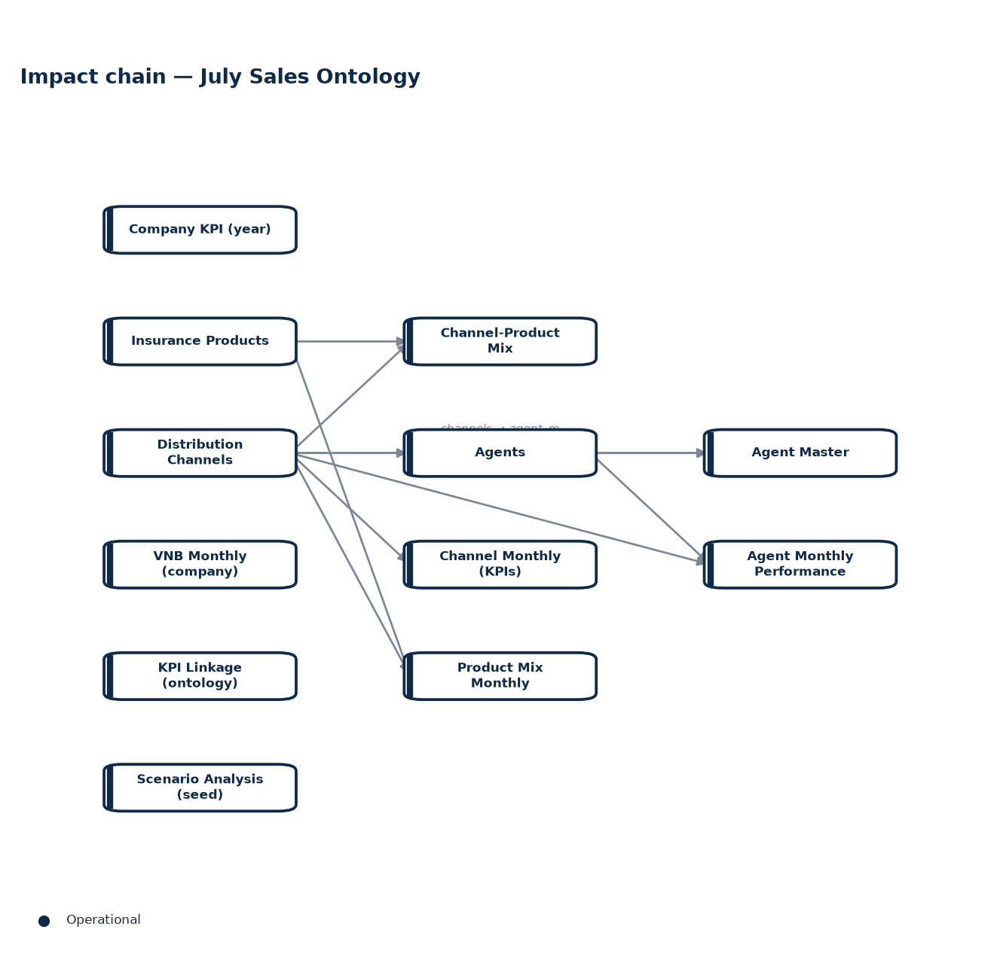
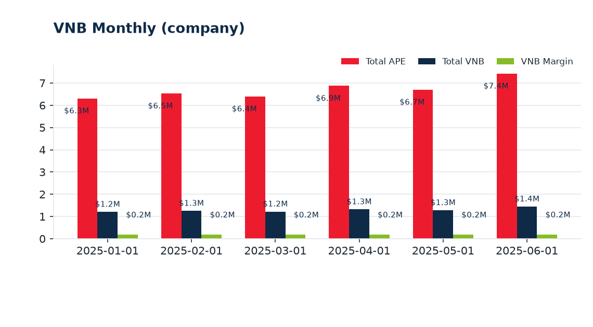
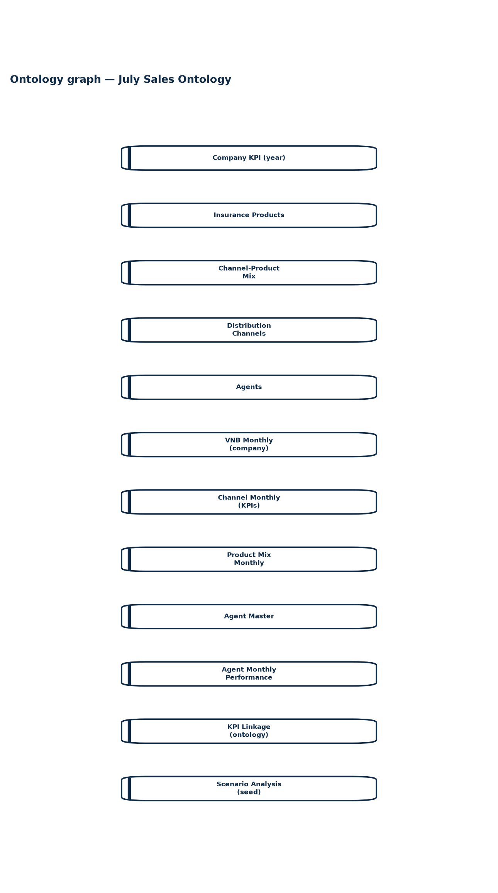

# July Sales Ontology Report | Scenario: July Sales Ontology | Data: Active dataset, Active dataset, Active dataset, Active dataset (+8 more)

**Date:** 2026-10-13  |  **Ontology pack:** July Sales Ontology  |  **Scope:** Pack  |  **Questions analysed:** 8

---

## 1. Executive Summary

- Ontology context — July Sales Ontology — relationship model  The graph contains **12 nodes** and **10 directed links** across 1 edge type(s).
- Analysed **8 question(s)** (8 rule-engine, 0 AI-assisted).
- Highest Unit-Linked at 25.0%; lowest Term Life at 10.0%. Grouped bars compare VNB Margin, Commission Rate, Expense Ratio.
- Highest item 2 at 66.0%; lowest item 4 at 5.0%. Grouped bars compare Mix Weight, Year.

## 2. Q&A Record

### 1. What is the total Total APE?

*Mode: **Rules Engine***

_No rule matched — ask this in AI mode for a model answer grounded in the same knowledge base._

### 2. What is the total Mix Weight?

*Mode: **Rules Engine***

_No rule matched — ask this in AI mode for a model answer grounded in the same knowledge base._

### 3. What is the total Total VNB?

*Mode: **Rules Engine***

_No rule matched — ask this in AI mode for a model answer grounded in the same knowledge base._

### 4. What is the total VNB Margin?

*Mode: **Rules Engine***

_No rule matched — ask this in AI mode for a model answer grounded in the same knowledge base._

### 5. What is the total Churn Rate?

*Mode: **Rules Engine***

_No rule matched — ask this in AI mode for a model answer grounded in the same knowledge base._

### 6. What is the total Productivity?

*Mode: **Rules Engine***

_No rule matched — ask this in AI mode for a model answer grounded in the same knowledge base._

### 7. What is the total Overall VNB Margin?

*Mode: **Rules Engine***

_No rule matched — ask this in AI mode for a model answer grounded in the same knowledge base._

### 8. What is the total Commission Rate?

*Mode: **Rules Engine***

_No rule matched — ask this in AI mode for a model answer grounded in the same knowledge base._

## 3. Ontology Evidence — Impact Chain

The diagram below shows the directed reasoning chain linking operational drivers to KPI outcomes captured by the analysed questions.

### Entity & attribute definitions

| Entity | Layer | Attributes |
| --- | --- | --- |
| Company KPI (year) | 3 | Year, Month, Total APE, Total VNB, Overall VNB Margin |
| Insurance Products | 3 | Product ID, Product Name, Product Type, VNB Margin, Commission Rate, Expense Ratio, Risk Discount Rate |
| Channel-Product Mix | 3 | Channel ID, Product ID, Mix Weight, Year, Product VNB Margin, Product Name, Channel Name |
| Distribution Channels | 3 | Channel ID, Channel Name, Agent Count, Churn Rate, Avg Productivity, Productivity Label, Channel APE, Blended VNB Margin, Channel VNB |
| Agents | 3 | Agent ID, Channel ID, Tenure (months), Productivity, Certification, Churn Risk, Status (latest month), Channel Name |
| VNB Monthly (company) | 3 | Month, Total APE, Total VNB, VNB Margin, Agency APE, Agency VNB, Agency share of VNB, MoM VNB change, Agency VNB MoM change, Agency contribution to VNB increase … |
| Channel Monthly (KPIs) | 3 | Month, Channel ID, Channel, Registered agents, Active agents, Active ratio, Avg productivity, APE, Weighted VNB margin, VNB … |
| Product Mix Monthly | 3 | Month, Channel ID, Product ID, Product, Product mix, VNB margin, Weighted margin component |
| Agent Master | 3 | Agent ID, Channel ID, Join date, Tenure at Jun-2025 (mo), Certification, Churn risk, Base productivity index |
| Agent Monthly Performance | 3 | Month, Agent ID, Channel ID, Status, Productivity, APE, Tenure (mo), Certification, Churn risk |
| KPI Linkage (ontology) | 3 | From entity, Relationship, To entity, Calculation / logic, Business interpretation, Example question enabled |
| Scenario Analysis (seed) | 3 | Scenario / input, Value, Unit / interpretation |

### Metric formulas (calculation basis)

| Metric | Formula |
| --- | --- |

## 4. Chart Analysis

### 1. Insurance Products

Highest **Unit-Linked** at 25.0%; lowest **Term Life** at 10.0%. Grouped bars compare VNB Margin, Commission Rate, Expense Ratio.
### 2. Channel-Product Mix

Highest **item 2** at 66.0%; lowest **item 4** at 5.0%. Grouped bars compare Mix Weight, Year.
### 3. Distribution Channels

Highest **Agency** at 390; lowest **Brokerage** at 70. Grouped bars compare Agent Count, Churn Rate, Avg Productivity.
### 4. VNB Monthly (company)

Highest **2025-06-01** at $7.4M; lowest **2025-01-01** at $6.3M. Grouped bars compare Total APE, Total VNB, VNB Margin.

## 5. Ontology Knowledge Graph

The full entity-relationship graph of the active ontology pack — the same
structure that powers Q&A, the dashboard and the analytics above.

## 6. Appendix

### Methodology & assumptions

- Answers are produced by Onti's rule engine against the active ontology pack; AI answers are grounded with the same knowledge base and must not introduce external facts.
- Derived columns and metric formulas are evaluated in declaration order from the active dataset; the calculation basis is listed in the Ontology Evidence section.
- Charts render only tables with 2-15 rows in their active dataset; sections are omitted when their source data is absent.

### Dataset inventory

| Table | Entity | Active dataset | Rows |
| --- | --- | --- | --- |
| Company KPI (year) | kpi | Active dataset | 0 |
| Insurance Products | products | Active dataset | 4 |
| Channel-Product Mix | mix | Active dataset | 4 |
| Distribution Channels | channels | Active dataset | 3 |
| Agents | agents | Active dataset | 500 |
| VNB Monthly (company) | vnb_monthly | Active dataset | 6 |
| Channel Monthly (KPIs) | channel_monthly | Active dataset | 18 |
| Product Mix Monthly | mix_monthly | Active dataset | 24 |
| Agent Master | agent_master | Active dataset | 500 |
| Agent Monthly Performance | agent_monthly | Active dataset | 3000 |
| KPI Linkage (ontology) | kpi_linkage | Active dataset | 7 |
| Scenario Analysis (seed) | scenario_data | Active dataset | 15 |

### Generation metadata

| Item | Value |
| --- | --- |
| Report ID | `cea7f309f017` |
| Generated at (UTC) | 2026-10-13T04:17:20+00:00 |
| Sections included | summary, qa, evidence, charts, ontology, appendix |
| AI interpretation | off |